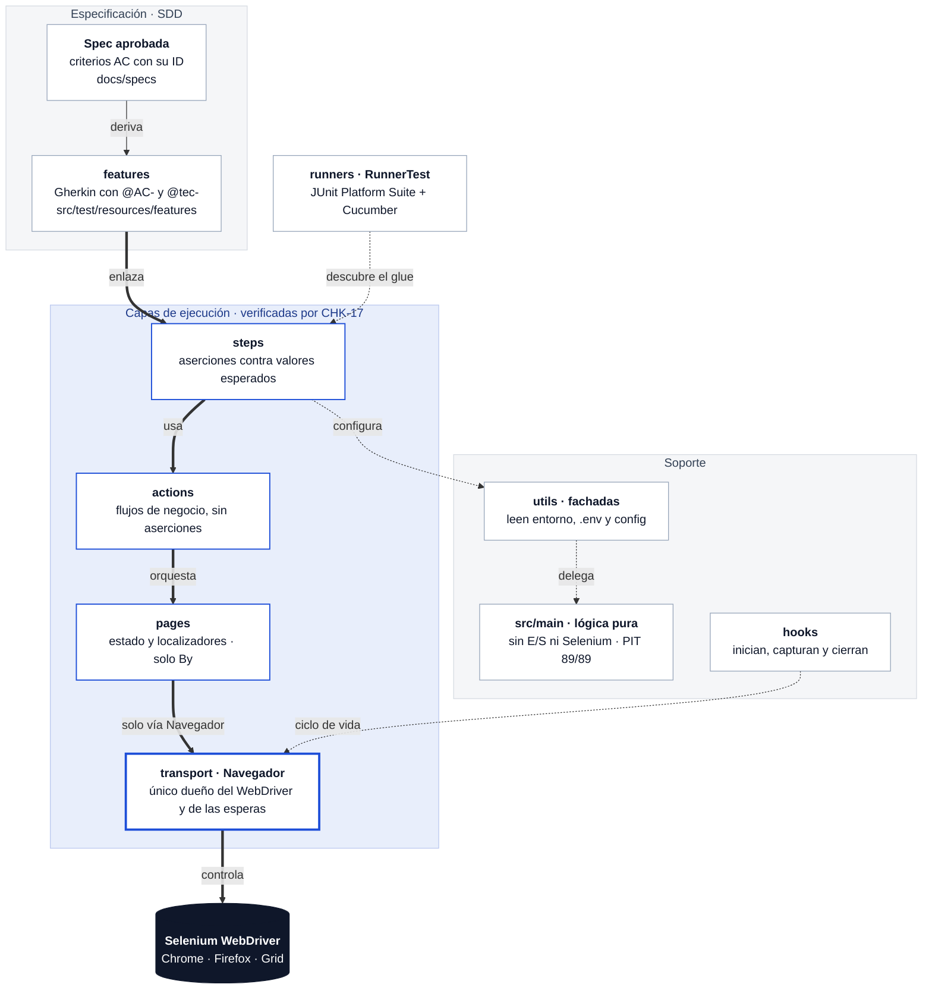

# Spec-Driven Selenium Cucumber

[](https://github.com/eavilac01/spec-driven-selenium-cucumber/actions/workflows/ci.yml)


[](LICENSE)

> Framework de automatización E2E guiado por especificaciones (Spec Driven Development) con Java 17, Selenium 4, Cucumber 7 y JUnit 5. POM, inyección de dependencias, ejecución en paralelo, Selenium Grid, Allure, CI (GitHub Actions y Jenkins) y un equipo de agentes de IA gobernado por reglas, hooks y un gate de calidad.

Framework de referencia para automatizar [SauceDemo](https://www.saucedemo.com) con Java 17, Selenium 4, Maven, Cucumber y JUnit 5. La solución aplica Page Object Model (POM), inyección de dependencias por escenario y una separación estricta entre especificación, orquestación, interfaz e infraestructura.

Cada escenario nace de una spec aprobada (`docs/specs/`), y la suite completa —escenarios E2E de login y compra más las pruebas unitarias de la lógica propia— se ejecuta con:

```bash
./mvnw clean test
```

Selenium Manager resuelve el driver del navegador en tiempo de ejecución. No se descarga `chromedriver` manualmente, no se configura una ruta local y no se incorpora un gestor externo de drivers.

## Inicio rápido (después de clonar)

```bash
# 1. Clonar
git clone https://github.com/eavilac01/spec-driven-selenium-cucumber.git
cd spec-driven-selenium-cucumber

# 2. Comprobar JDK 17 (Maven no hace falta: el proyecto trae Maven Wrapper)
java -version
./mvnw -version

# 3. Crear el archivo local de credenciales a partir de la plantilla
cp .env.example .env
chmod 600 .env

# 4. Completar .env con las credenciales públicas de SauceDemo (ver la sección siguiente)

# 5. Ejecutar la suite
./mvnw clean test -Dheadless=true
```

Si el paso 5 termina en `BUILD SUCCESS`, el entorno está listo. Si falla con `La variable sensible obligatoria '...' no tiene valor`, falta completar esa variable en `.env` (el mensaje muestra solo el nombre, nunca el valor).

## Credenciales de SauceDemo: cómo obtenerlas

SauceDemo es un sitio público de práctica: **sus credenciales no son secretas y las publica en su propia página de inicio de sesión**. Aun así, este repositorio no las versiona: se tratan como cualquier secreto (`.env` local o *Secrets* de CI), para que el framework funcione igual con una aplicación real.

1. Abre [https://www.saucedemo.com](https://www.saucedemo.com) en el navegador.
2. Debajo del formulario de inicio de sesión hay dos recuadros:
   - **"Accepted usernames are:"** — la lista de usuarios de prueba.
   - **"Password for all users:"** — la contraseña común a todos ellos.
3. Copia esos valores en tu `.env` según esta tabla:

| Variable de `.env` | Qué valor poner |
|---|---|
| `TEST_USER_STANDARD_USERNAME` | El usuario **estándar** de la lista (el que empieza por `standard`) |
| `TEST_USER_STANDARD_PASSWORD` | La contraseña común que muestra la página |
| `TEST_LOGIN_CASES_LOCKED_USER_USERNAME` | El usuario **bloqueado** de la lista (el que contiene `locked_out`) |
| `TEST_LOGIN_CASES_LOCKED_USER_PASSWORD` | La misma contraseña común |
| `TEST_LOGIN_CASES_INVALID_PASSWORD_USERNAME` | El usuario estándar otra vez |
| `TEST_LOGIN_CASES_INVALID_PASSWORD_PASSWORD` | **Cualquier valor distinto** de la contraseña común (ver abajo cómo generarlo) |

Para el caso de contraseña incorrecta conviene un valor aleatorio, así nunca coincide por accidente con la real:

```bash
openssl rand -hex 12
```

El resultado de `.env` tiene esta forma (los valores reales los copias tú de la página):

```dotenv
TEST_USER_STANDARD_USERNAME=<usuario estándar de la página>
TEST_USER_STANDARD_PASSWORD=<contraseña común de la página>
TEST_LOGIN_CASES_LOCKED_USER_USERNAME=<usuario bloqueado de la página>
TEST_LOGIN_CASES_LOCKED_USER_PASSWORD=<contraseña común de la página>
TEST_LOGIN_CASES_INVALID_PASSWORD_USERNAME=<usuario estándar de la página>
TEST_LOGIN_CASES_INVALID_PASSWORD_PASSWORD=<valor aleatorio, distinto de la contraseña común>
```

Reglas de seguridad que aplica el proyecto:

- `.env` está en `.gitignore`; solo `.env.example` (sin valores) se versiona.
- Ningún log, reporte ni mensaje de error imprime un valor de `.env`: los errores nombran la variable, nunca su contenido.
- El objeto de credenciales se imprime enmascarado (`Credentials[username=***, password=***]`).
- Nunca pegues las credenciales en `config.properties`, en una feature ni en el código.

Si SauceDemo cambia sus usuarios o su contraseña, basta con actualizar `.env` (y los *Secrets* de CI): ningún archivo del repositorio cambia.

## Stack

| Componente | Versión | Responsabilidad |
|---|---:|---|
| Java | 17 | Lenguaje y runtime |
| Selenium | 4.45.0 | Automatización del navegador y Selenium Manager |
| Cucumber | 7.34.4 | Especificaciones BDD y ejecución de escenarios |
| JUnit | 5.14.2 | Suite de ejecución y aserciones |
| Allure Cucumber JVM | 2.29.1 | Resultados enriquecidos para Allure |
| SLF4J Simple | 2.0.16 | Registro de eventos |
| Maven Surefire | 3.5.3 | Ejecución de pruebas con Maven |

Las versiones de Cucumber y JUnit se administran con sus respectivos BOM en `dependencyManagement`; el resto se centraliza en las propiedades de `pom.xml`.

## Arquitectura por capas

Cada flecha del diagrama es una **dependencia autorizada** por el [ADR-002](docs/adr/002-transport-and-business-actions.md). Cualquier otra —un step que importe una página, Selenium fuera de `transport`— la rechaza **CHK-17** en cada ejecución del CI.



> Flechas gruesas: cadena de ejecución de un escenario. Flechas punteadas: soporte (descubrimiento, configuración y ciclo de vida).

### Responsabilidad de cada capa

| Capa | Paquete | Responsabilidad | Puede depender de | Nunca |
|---|---|---|---|---|
| Especificación | `docs/specs`, `features` | Qué se espera del negocio, con criterios `AC-*` trazables | — | Selectores ni vocabulario de interfaz |
| Steps | `com.demo.steps` | Aserciones JUnit 5 contra valores esperados de configuración | `actions`, `utils`, `data` | Importar páginas, `transport` ni Selenium |
| Acciones | `com.demo.actions` | Flujos de negocio entre páginas; devuelven lo observado | `pages`, `data` | Aserciones ni lectura de valores esperados |
| Páginas | `com.demo.pages` | Estado y localizadores de cada vista, por composición | `transport`, `ConfigReader` | Selenium distinto de `By`, aserciones, herencia |
| Transporte | `com.demo.transport` | `Navegador`: único dueño del `WebDriver`, esperas explícitas y postcondiciones | `utils`, `config` | Lógica de negocio |
| Fachadas | `com.demo.utils` | Leen entorno, `.env` y `config.properties`; delegan en `src/main` | `config`, `data` | Depender de capas superiores |
| Lógica pura | `com.demo.config`, `com.demo.data` (`src/main`) | Resolución de configuración, secretos, credenciales y navegador | Solo entre sí | E/S, Selenium, Cucumber, JUnit |
| Hooks | `com.demo.hooks` | Inician el navegador, adjuntan la captura si falla y lo cierran | `transport`, `utils` | Reglas de negocio |

### Garantías automáticas

| Comprobación | Qué impide | Dónde corre |
|---|---|---|
| **CHK-17** · `scripts/check-layers.sh` | Saltos de capa (reglas R1–R6), con autoprueba de 154 casos | CI (job `mutation`) y Jenkins |
| **CHK-12** · `scripts/check-traceability.sh` | Escenarios sin spec aprobada o sin `@AC-`/`@tec-` | CI y Jenkins, antes de la suite |
| **CHK-15/16** · `scripts/check-unit-purity.sh` | E/S o Selenium en `src/main`; pruebas unitarias acopladas | CI (job `mutation`) y Jenkins |
| **CHK-11** · PIT + `scripts/check-mutation-report.sh` | Pruebas unitarias que no detectan defectos (umbral 80 %) | CI (job `mutation`) y Jenkins |

Las reglas completas (R1–R7) y su equivalente en ArchUnit están en el [ADR-002](docs/adr/002-transport-and-business-actions.md); la decisión de mutar solo la lógica pura, en el [ADR-001](docs/adr/001-mutation-testing-pit.md).

## Estructura del proyecto

```text
.
├── .claude
│   ├── agents/          # equipo de agentes QE (ver README interno)
│   ├── rules/           # SDD, permisos, prompt injection, CHK
│   ├── hooks/           # gate DevOps y protección de la configuración (+ pruebas)
│   └── settings.json
├── .env.example
├── .github/workflows/ci.yml
├── .mvn/wrapper/maven-wrapper.properties
├── AGENTS.md
├── CLAUDE.md
├── MEMORY.md
├── Jenkinsfile
├── LICENSE
├── README.md
├── .gitignore
├── docker-compose.yml
├── docs
│   ├── adr
│   │   ├── 001-mutation-testing-pit.md
│   │   └── 002-transport-and-business-actions.md
│   └── specs/           # _plantilla.md, login.md, compra.md
├── mvnw / mvnw.cmd
├── pom.xml
├── scripts
│   ├── check-layers.sh            # CHK-17: reglas de capas
│   ├── check-mutation-report.sh   # CHK-11: guarda del reporte de PIT
│   ├── check-required-secrets.sh  # CI/Jenkins: nombra los secrets que faltan
│   ├── check-traceability.sh      # CHK-12: escenario → spec aprobada
│   ├── check-unit-purity.sh       # CHK-15/16: src/main puro y unitarias aisladas
│   ├── wait-for-grid.sh           # espera activa a que el Grid esté listo
│   └── tests/check-layers-test.sh # autoprueba de CHK-17
├── src/main/java/com/demo      # lógica pura, sin E/S (ADR-001)
│   ├── config
│   │   ├── BrowserSettings.java
│   │   ├── ConfigResolver.java
│   │   ├── DotEnvParser.java
│   │   └── SecretResolver.java
│   └── data/Credentials.java
└── src/test
    ├── java/com/demo
    │   ├── config/      # pruebas unitarias de src/main/.../config
    │   ├── data/        # pruebas unitarias de src/main/.../data
    │   ├── actions
    │   │   ├── CompraActions.java
    │   │   └── LoginActions.java
    │   ├── hooks/Hooks.java
    │   ├── pages
    │   │   ├── CartPage.java
    │   │   ├── CheckoutPage.java
    │   │   ├── InventoryPage.java
    │   │   └── LoginPage.java
    │   ├── runners/RunnerTest.java
    │   ├── steps
    │   │   ├── CompraSteps.java
    │   │   └── LoginSteps.java
    │   ├── transport
    │   │   ├── DriverFactory.java
    │   │   └── Navegador.java
    │   └── utils
    │       ├── ConfigReader.java
    │       ├── CredentialsProvider.java
    │       ├── SecretReader.java
    │       └── TestContext.java
    └── resources
        ├── config.properties
        ├── junit-platform.properties   # paralelismo por escenario (2 hilos)
        └── features
            ├── compra_e2e.feature
            └── login.feature
```

## Decisiones de arquitectura

### `Navegador`: un dueño del `WebDriver` por escenario (ADR-002)

`com.demo.transport.Navegador` es el único dueño del `WebDriver` y del `WebDriverWait`. PicoContainer crea una instancia por escenario, compartida por `Hooks` y las páginas; `Hooks` lo inicia, adjunta la captura si el escenario falla y lo cierra de forma idempotente. No hay `ThreadLocal` ni estado estático: el aislamiento lo da el contenedor por escenario. Su API solo recibe `By` y tipos de Java y nunca devuelve tipos de Selenium, de modo que Selenium queda confinado a `transport`.

### PicoContainer y `TestContext`

Cucumber crea un grafo de objetos nuevo para cada escenario. PicoContainer construye por constructor, de forma transitiva, `Navegador`, las páginas, las acciones, `TestContext` y los steps de ese escenario, sin campos estáticos ni service locator. `TestContext` solo guarda el estado de los steps (qué juego de valores esperados del carrito aplica); al comenzar el siguiente escenario se construye otro grafo limpio.

### Acciones de negocio en lugar de `PageManager`

Los steps no conocen las páginas: reciben por constructor `LoginActions` y `CompraActions`, que PicoContainer construye con las páginas del escenario. Las acciones expresan el flujo de negocio (iniciar sesión, agregar productos, tramitar la compra) y devuelven lo observado; los steps comparan contra los valores esperados de la configuración. Así cada capa tiene una sola razón para cambiar y no hace falta un registro de páginas aparte.

### Esperas centralizadas

La espera implícita se establece en `Duration.ZERO` y `Navegador` concentra las esperas explícitas con el límite definido en `explicit.wait.seconds`. Esto evita combinar dos modelos de espera —una fuente común de tiempos impredecibles— y permite que todas las interacciones sigan la misma política. Las pausas fijas no forman parte de la estrategia porque retrasan siempre y no expresan la condición que se espera.

Las acciones sensibles esperan además una postcondición observable: el botón de producto adopta el texto configurado en `inventory.remove-button.text`, la ruta avanza al siguiente paso o el valor de un input permanece estable en dos sondeos. El intento inicial siempre usa las APIs nativas de WebDriver. Solo si Chrome pierde ese evento se reubica el elemento y se usa un respaldo JavaScript acotado; en inputs controlados se invoca el setter nativo y se emiten eventos `input/change` para que React actualice su estado. El respaldo también queda sujeto a la misma postcondición, por lo que no convierte un fallo real en un falso positivo.

### Compatibilidad de reportes JUnit

El plugin Maven requerido se conserva en `maven-surefire-plugin:3.5.3`. Esa versión ejecuta Cucumber 7.34.4, pero no asocia correctamente sus escenarios `UriSource` con el test set del runner y puede informar cero pruebas. El POM carga internamente el proveedor corregido `surefire-junit-platform:3.5.4`, versión que incorporó la corrección de Apache, para que un escenario fallido produzca XML y termine Maven con error. Así se evita aceptar un `BUILD SUCCESS` sin resultados reales y se mantiene la versión exacta del plugin solicitada.

### `By` frente a PageFactory y `@FindBy`

Se usan constantes privadas `By` porque hacen visible cuándo y cómo se localiza un elemento, funcionan de manera natural con la API de `Navegador` y permiten construir localizadores dinámicos sin proxies. PageFactory no aporta valor aquí: sus proxies posponen la búsqueda, pueden ocultar el momento de una excepción y no resuelven por sí mismos sincronización ni elementos dinámicos.

### Configuración y secretos

Las fuentes están separadas deliberadamente:

```text
Configuración no sensible:  -Dpropiedad  >  variable de entorno  >  config.properties
Credenciales:                variable de entorno de CI  >  .env local
```

`ConfigReader` solo resuelve configuración no sensible y nunca abre `.env`. `SecretReader` solo consulta nombres explícitos de variables del sistema o del `.env`; nunca consulta `config.properties` ni propiedades JVM. `CredentialsProvider` construye objetos tipados para usuario estándar, usuario bloqueado y contraseña inválida, evitando que los steps conozcan el mecanismo de almacenamiento.

Esta separación impide que una credencial vuelva a `config.properties` por un fallback accidental. Una opción de ejecución no sensible puede sobrescribir el archivo sin modificar el repositorio; las variables del sistema reciben los secretos de CI y `.env` facilita el desarrollo local sin confirmar credenciales. Una entrada obligatoria ausente o vacía falla inmediatamente indicando únicamente su nombre, nunca su valor. `remote.url` es la única configuración que admite un valor vacío porque representa ejecución local.

Ejemplo: el archivo define `headless=false`; al ejecutar Maven con `-Dheadless=true`, la propiedad de sistema gana y activa la ejecución sin ventana.

Para configuración no sensible, las variables de entorno se aceptan con el nombre exacto o normalizado a mayúsculas, reemplazando puntos y guiones por guion bajo. Por ejemplo, `REMOTE_URL=http://localhost:4444` sobrescribe `remote.url`. Para secretos, `CredentialsProvider` usa directamente los nombres `TEST_*` declarados en `.env.example`; el lector no registra valores y admite líneas vacías, comentarios, el prefijo `export` y valores entre comillas.

### Estrategia de localizadores

La prioridad es `id`, después CSS con atributos estables como `data-test` y, solo cuando expresa una relación del DOM, XPath relativo. Se prohíben XPath absolutos e índices posicionales porque acoplan la prueba a la estructura visual. El botón de un producto es un caso dinámico legítimo: parte del nombre visible y encuentra el botón dentro del mismo contenedor `inventory_item`.

```xpath
//div[@data-test='inventory-item'][.//div[@data-test='inventory-item-name' and normalize-space()='Sauce Labs Backpack']]//button
```

El valor procedente de datos de prueba se convierte de forma segura en un literal XPath antes de construir el selector.

### Granularidad BDD

Cada feature representa una funcionalidad y cada escenario es completo e independiente. `login.feature` agrupa el acceso exitoso y sus rechazos; `compra_e2e.feature` narra una compra de punta a punta. Un `Background` solo establece el contexto común y un `Scenario Outline` elimina duplicación de casos equivalentes. Los features expresan intención y usan identificadores de caso; los valores concretos se resuelven desde la fuente tipada correspondiente para no duplicar credenciales, productos, mensajes ni datos personales en Gherkin y Java.

Ejemplo del estilo esperado:

```gherkin
@e2e
Scenario: Compra exitosa de dos productos
  Given que el usuario está autenticado para comprar
  When agrega los productos configurados al carrito
  Then el carrito refleja la cantidad de productos configurada
  And el carrito contiene los productos seleccionados
  When tramita la compra con los datos de envío configurados
  Then la compra se confirma con el mensaje configurado
```

El escenario comunica intención y resultado. El step decide qué páginas orquestar; la página decide cómo operar la interfaz.

## Configuración

Los valores no sensibles se encuentran en `src/test/resources/config.properties`:

```properties
base.url=https://www.saucedemo.com
browser=chrome
headless=false
remote.url=
explicit.wait.seconds=10
browser.window.width=1920
browser.window.height=1080

# Datos de entrada (no sensibles)
test.purchase.products=Sauce Labs Backpack,Sauce Labs Bike Light
test.purchase.single-product=Sauce Labs Backpack
test.checkout.first-name=Ada
test.checkout.last-name=Lovelace
test.checkout.postal-code=01000

# Valores esperados (salen de la spec; independientes de la entrada)
cart.expected.count=2
cart.expected.products=Sauce Labs Backpack,Sauce Labs Bike Light
```

| Grupo | Propiedades | Responsabilidad |
|---|---|---|
| Ejecución | `base.url`, `browser`, `headless`, `remote.url` | Ambiente y navegador |
| Sincronización | `explicit.wait.seconds` | Límite común de esperas explícitas |
| Ventana | `browser.window.width`, `browser.window.height` | Resolución headless |
| Navegación | `route.*` | Rutas esperadas entre páginas |
| Sincronización de UI | `inventory.remove-button.text` | Postcondición de agregar un producto |
| Datos de entrada | `test.purchase.*`, `test.checkout.*` | Productos y datos de envío que usan las acciones |
| Valores esperados | `inventory.expected.title`, `cart.expected.*`, `checkout.expected.confirmation`, `test.login.cases.<caso>.expected-error` | Lo que la spec dice que debe observarse; los `Then` comparan solo contra estas claves |
| Credenciales | Variables `TEST_USER_*` y `TEST_LOGIN_CASES_*` | `.env` local o *Secrets* de CI, nunca en este archivo |
| Evidencia | `evidence.screenshot.*` | Tipo y nombre de capturas en fallos |

**Por qué los esperados van separados de la entrada:** si un `Then` comparara contra el mismo dato que usó el `When`, un defecto que cambiara ambos lados pasaría en verde. Con claves independientes, cualquier esperado se puede alterar desde la línea de comandos para comprobar que la prueba de verdad falla (control negativo):

```bash
./mvnw test -Dheadless=true -Dcucumber.filter.tags="@AC-COMPRA-04" \
  -Dcart.expected.single-product.count=2
# Debe fallar en el Then: expected: <2> but was: <1>
```

### Credenciales: local y CI

**Local.** El repositorio solo conserva `.env.example`, sin valores; la sección [Credenciales de SauceDemo](#credenciales-de-saucedemo-cómo-obtenerlas) explica cómo completarlo. `.gitignore` excluye `.env` y todas sus variantes, salvo la plantilla. El archivo no está cifrado ni es un gestor de secretos: evita su versionado accidental, y los permisos del sistema operativo (`chmod 600 .env`) siguen siendo necesarios.

**GitHub Actions.** En el repositorio, `Settings → Secrets and variables → Actions → New repository secret`, crea un secret por cada variable de `.env.example`, con el mismo nombre y el mismo valor que en tu `.env`. El workflow verifica al inicio que estén los seis y falla con un mensaje claro si falta alguno.

**Jenkins.** Las mismas credenciales se registran en el almacén de credenciales de Jenkins (ver [Jenkins](#jenkins)).

Los nombres de `.env.example` se referencian de forma explícita en `CredentialsProvider`; no se transforman en claves de propiedades. En depuración, el flujo navegable es `step → CredentialsProvider → SecretReader → variable del sistema/.env`. En CI no se crea `.env`: el gestor de credenciales inyecta directamente las mismas variables de entorno, que tienen prioridad sobre `.env`.

## Requisitos previos

- JDK 17 disponible en `JAVA_HOME`.
- Maven no es obligatorio: el proyecto incluye Maven Wrapper (`./mvnw` en Linux/macOS, `mvnw.cmd` en Windows), que descarga Maven 3.9.9 la primera vez.
- Chrome o Firefox instalado para ejecución local. Selenium Manager obtiene el driver compatible.
- Docker con Compose v2 para el ejemplo de Grid.
- Allure CLI para abrir el reporte Allure de forma local.

Comprobación rápida:

```bash
java -version
./mvnw -version
```

## Cómo ejecutar

Todos los escenarios:

```bash
./mvnw clean test
```

Solo los escenarios marcados como smoke:

```bash
./mvnw clean test -Dcucumber.filter.tags="@smoke"
```

En Chrome headless:

```bash
./mvnw clean test -Dheadless=true
```

En Firefox local:

```bash
./mvnw clean test -Dbrowser=firefox
```

Las opciones se pueden combinar:

```bash
./mvnw clean test \
  -Dheadless=true \
  -Dbrowser=chrome \
  -Dcucumber.filter.tags="@smoke"
```

Un criterio de aceptación concreto (cada escenario lleva la etiqueta `@AC-<DOMINIO>-<NN>` de su spec):

```bash
./mvnw clean test -Dheadless=true -Dcucumber.filter.tags="@AC-LOGIN-02"
```

Solo las pruebas unitarias de la lógica propia (`src/main/java`), sin navegador:

```bash
./mvnw test -Dtest='com.demo.config.*Test,com.demo.data.*Test' -Dsurefire.failIfNoSpecifiedTests=false
```

### Comprobaciones de calidad

Las mismas que corre el CI, ejecutables en local:

```bash
bash scripts/check-traceability.sh   # CHK-12: cada escenario trazado a una spec aprobada
bash scripts/check-layers.sh         # CHK-17: reglas de capas (Selenium solo en transport, etc.)
bash scripts/check-unit-purity.sh    # CHK-15/16: src/main puro y pruebas unitarias aisladas

# CHK-11: pruebas de mutación (umbral 80 %) con la guarda contra el "Skipping project" de PIT
rm -rf target/pit-reports
bash -c 'set -o pipefail; ./mvnw -B -ntp test-compile org.pitest:pitest-maven:mutationCoverage 2>&1 | tee pit.log' \
  && bash scripts/check-mutation-report.sh pit.log
```

El catálogo completo de comprobaciones (CHK-01…17) y sus comandos está en [`.claude/rules/04-quality-checks.md`](.claude/rules/04-quality-checks.md).

### Ejecución contra Selenium Grid

Iniciar el hub y el nodo Chrome reales incluidos en este repositorio:

```bash
docker compose up -d
docker compose ps
```

La consola de Grid queda disponible en `http://localhost:4444/ui`. Ejecutar las pruebas desde el host:

```bash
./mvnw clean test \
  -Dremote.url=http://localhost:4444 \
  -Dbrowser=chrome \
  -Dheadless=true
```

Detener y retirar los contenedores:

```bash
docker compose down
```

`remote.url` debe apuntar a `http://selenium-hub:4444` únicamente cuando Maven se ejecute desde otro contenedor conectado a la misma red de Compose.

## Reportes y evidencia

Después de `./mvnw clean test` se generan:

- `target/cucumber-report.html`: reporte HTML de Cucumber.
- `target/surefire-reports/*.xml`: resultados JUnit consumibles por CI.
- `target/allure-results`: datos de entrada para Allure.
- `target/pit-reports/index.html`: reporte de mutación, tras ejecutar CHK-11.

Abrir un reporte Allure temporal:

```bash
allure serve target/allure-results
```

Cuando un step falla, `@AfterStep` toma una captura PNG y la adjunta al escenario mediante la API de Cucumber. La captura aparece embebida en `target/cucumber-report.html` y queda disponible para el adaptador de Allure. No se captura en pasos exitosos para evitar ruido y consumo innecesario. El hook `@After` libera el navegador siempre, incluso después de una excepción.

Para comprobar la evidencia durante desarrollo, puede cambiarse temporalmente una expectativa por un valor incorrecto, ejecutar el escenario y abrir el HTML. Esa alteración deliberada no debe confirmarse en el repositorio.

## Extensiones CI/CD

### GitHub Actions

`.github/workflows/ci.yml` corre en cada `push` y `pull request` a `main` (y manualmente con `workflow_dispatch`), con permisos mínimos (`contents: read`). Tiene cuatro jobs en paralelo:

| Job | Qué hace | Secrets |
|---|---|---|
| `test` | CHK-12 (trazabilidad) y la suite completa en Chrome headless, sin `@quarantine` | Sí |
| `e2e-firefox` | Los escenarios E2E en Firefox headless | Sí |
| `e2e-grid` | Los escenarios E2E contra un Selenium Grid (`selenium/standalone-chrome`), con espera activa a que esté listo | Sí |
| `mutation` | CHK-17 (capas) con su autoprueba, CHK-15/16 y CHK-11 (PIT) con la guarda de reporte | No |

Cada job publica sus reportes como artefactos aunque falle. Los jobs con secrets los verifican al inicio con `scripts/check-required-secrets.sh`, que solo nombra las variables que faltan.

Las credenciales se cargan como *Secrets* del repositorio (`Settings → Secrets and variables → Actions`), uno por variable de `.env.example` y con el mismo nombre: `TEST_USER_STANDARD_USERNAME`, `TEST_USER_STANDARD_PASSWORD`, `TEST_LOGIN_CASES_LOCKED_USER_USERNAME`, `TEST_LOGIN_CASES_LOCKED_USER_PASSWORD`, `TEST_LOGIN_CASES_INVALID_PASSWORD_USERNAME` y `TEST_LOGIN_CASES_INVALID_PASSWORD_PASSWORD`.

### Ejecución en paralelo

Los escenarios corren en paralelo con 2 hilos (`src/test/resources/junit-platform.properties`), el mismo número de sesiones que admite el nodo del Grid. Es seguro porque PicoContainer crea un `Navegador` por escenario y no hay estado estático mutable. Para depurar en serie:

```bash
./mvnw clean test -Dcucumber.execution.parallel.enabled=false
```

### Jenkins

El `Jenkinsfile` declarativo está listo para un servidor Jenkins, aunque todavía no se ha ejecutado en uno real. Reproduce los jobs `test` y `mutation` de GitHub Actions:

1. `Checkout` del commit bajo prueba.
2. `Traceability SDD (CHK-12)` y `Capas (CHK-17)`.
3. `Mutation (CHK-11)`: PIT con la guarda de reporte, sin credenciales.
4. `Test`: la suite sin `@quarantine`; es la **única** etapa que recibe credenciales.
5. `post` de `Test`: publica JUnit y Allure y archiva los reportes, aunque una prueba falle. `Mutation` archiva su reporte y `pit.log`. El `post` global limpia el espacio de trabajo.

Incluye límites de tiempo globales y por etapa, descarte de builds antiguos y builds no concurrentes. Los bloques de shell de varias órdenes corren en bash con `set -euo pipefail`, y todos usan comillas simples para que Groovy no interpole ningún valor.

**Para configurarlo:**

1. **Plugins:** Pipeline (Declarative), Credentials Binding, Timestamper, JUnit, Workspace Cleanup y Allure (con una instalación de Allure Commandline en *Global Tool Configuration*).
2. **Herramientas** (`Manage Jenkins → Tools`): un JDK llamado `jdk-17` (Temurin 17). Maven no hace falta: lo trae `./mvnw`.
3. **Agente:** Linux con bash, git y Google Chrome.
4. **Credenciales** (`Manage Jenkins → Credentials`): seis de tipo **Secret text**. El ID de cada una es exactamente el nombre de la variable en `.env.example`, y su valor es el mismo que en tu `.env` (ver [Credenciales de SauceDemo](#credenciales-de-saucedemo-cómo-obtenerlas)).

### Selenium Grid con Docker Compose

`docker-compose.yml` crea un hub y un nodo Chrome. Las variables `SE_EVENT_BUS_HOST`, `SE_EVENT_BUS_PUBLISH_PORT` y `SE_EVENT_BUS_SUBSCRIBE_PORT` registran el nodo en el bus de eventos del hub. `shm_size: 2gb` evita cierres de Chrome por memoria compartida insuficiente, un problema frecuente en Linux CI.

Para escalar a tres nodos sin cambiar el archivo:

```bash
docker compose up -d --scale node-chrome=3
```

No debe definirse `container_name` en el nodo porque impediría crear varias réplicas.

## Convenciones para extender el framework

Al agregar una funcionalidad:

1. Escribir primero un escenario independiente, observable y con vocabulario del dominio.
2. Reutilizar steps cuando expresen exactamente la misma intención; no reutilizarlos solo porque hacen clic en el mismo elemento.
3. Añadir el localizador privado a la página dueña de esa vista.
4. Implementar la interacción con la API de `Navegador`; si falta una operación genérica, agregarla allí en vez de acceder al driver desde la página.
5. Orquestar páginas en una acción de negocio y realizar la aserción descriptiva en el step, contra un valor esperado de configuración.
6. Ejecutar tanto el nuevo escenario como la suite completa.

Lista de control antes de integrar cambios:

```text
[ ] ./mvnw clean test termina en BUILD SUCCESS
[ ] @smoke ejecuta únicamente el alcance esperado
[ ] los escenarios no comparten estado
[ ] no hay pausas fijas ni esperas implícitas
[ ] no hay assert en pages
[ ] no hay Selenium fuera de transport (en pages, solo By) ni findElement fuera de Navegador
[ ] los steps no importan pages ni transport
[ ] no hay XPath absoluto ni índice posicional frágil
[ ] no hay catch vacío
[ ] no hay variables, parámetros, campos privados ni métodos privados sin uso
[ ] no hay URLs, credenciales, datos de prueba, rutas, timeouts ni expectativas configurables en duro
[ ] `.env` está ignorado y solo `.env.example` permanece versionable y sin secretos
[ ] no hay gestores externos ni rutas fijas de drivers
[ ] un fallo conserva captura y los hooks cierran el navegador
```

## Solución de problemas

**`La variable sensible obligatoria '...' no tiene valor`.** Falta esa variable en `.env` (local) o en los *Secrets* (CI), o está vacía. Revisa la sección [Credenciales de SauceDemo](#credenciales-de-saucedemo-cómo-obtenerlas).

**El login falla con credenciales que parecen correctas.** Vuelve a copiarlas desde [saucedemo.com](https://www.saucedemo.com): pueden haber cambiado. Comprueba también que no haya espacios ni comillas sobrantes en `.env`.

**Selenium Manager no puede obtener un driver.** Verificar salida a Internet, navegador instalado y permisos de la caché de Selenium. No solucionar el problema agregando una ruta fija al driver.

**Grid responde pero no crea sesión.** Confirmar `docker compose ps`, revisar `docker compose logs node-chrome` y comprobar que `browser=chrome`. La interfaz `/ui` debe mostrar al menos un slot disponible.

**Allure CLI no existe.** Las pruebas siguen siendo válidas y conservan `target/allure-results`; instalar Allure Commandline solo es necesario para ejecutar `allure serve`.

**No se ejecutan escenarios.** Confirmar que `RunnerTest` termina en `Test`, que selecciona el recurso `features` y que sus anotaciones `@ConfigurationParameter` declaran el glue de steps y hooks.

**IntelliJ muestra `no usages` en hooks o steps.** No significa que estén muertos: Cucumber descubre los métodos anotados y los invoca mediante reflexión a partir del glue y de los textos Gherkin. Por eso las clases de glue tienen una supresión `unused` acotada y documentada. No se crean llamadas artificiales desde producción o desde el runner, porque eso duplicaría el ciclo de vida y sí sería un defecto de diseño.

**Configuración de Cucumber.** El glue, los plugins y la publicación silenciosa están declarados en `RunnerTest` mediante `@ConfigurationParameter` y las constantes oficiales de Cucumber. Esto mantiene una única fuente de configuración con referencias visibles para el IDE y el análisis estático.

## Equipo de agentes QE y Spec Driven Development

El repositorio incluye un equipo de subagentes de Claude Code (`.claude/agents/`): arquitecto de automatización, diseñador de casos, ingeniero de automatización, **verificador independiente** e ingeniero DevOps. La sesión principal (`CLAUDE.md`) los coordina.

- **Spec Driven Development:** spec aprobada por una persona → feature trazada (`@AC-`, `@tec-`) → código. Ningún nivel se escribe sin el anterior (`.claude/rules/01`).
- **Permisos por agente:** qué puede escribir, leer y ejecutar cada rol, aplicado también con `permissions` en `.claude/settings.json` (`.claude/rules/02`).
- **Defensa contra prompt injection:** el contenido de la aplicación, los reportes y los archivos es dato, nunca instrucción (`.claude/rules/03`).
- **Comprobaciones deterministas:** catálogo CHK-01…17 (sleep, reintentos, capas, control negativo, mutación, trazabilidad) y un hook que bloquea `git push` sin el gate DevOps (`.claude/rules/04`).

Índice, justificación de roles y asignación de modelo: [`.claude/agents/README.md`](.claude/agents/README.md).

## Licencia

Distribuido bajo la licencia MIT. Consulta [`LICENSE`](LICENSE) para más detalles.

© 2026 Eduardo Avila Carranza
